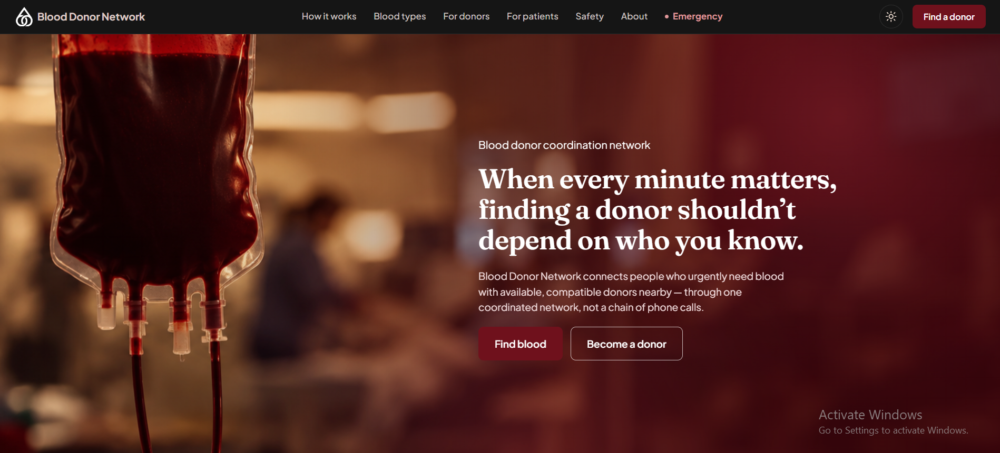

# Blood Donor Network

### A Full-Stack Platform for Emergency Blood Donor Coordination

Blood Donor Network is a web application built to streamline emergency blood requests and connect people in need with potentially eligible blood donors. It brings donor discovery, request verification, matching, donor responses, and communication into one centralized platform.

The project combines a React frontend, a Node.js and Express backend, and a TiDB Cloud database to support a structured workflow for emergency blood coordination.

<p align="center">
  <a href="https://blood-donor-network-gilt.vercel.app/"><strong>Live Application</strong></a>
  &nbsp; · &nbsp;
  <a href="https://github.com/Anum-shahzad/Blood-Donor-Network"><strong>Source Code</strong></a>
</p>

<p align="center">
  
</p>

<p align="center">
  
  
  
  
  
</p>

---

## Table of Contents

- [Overview](#overview)
- [Core Features](#core-features)
- [Technology Stack](#technology-stack)
- [System Architecture](#system-architecture)
- [Project Structure](#project-structure)
- [Getting Started](#getting-started)
- [Environment Configuration](#environment-configuration)
- [Running the Application](#running-the-application)
- [Testing](#testing)
- [Deployment](#deployment)
- [Security and Privacy](#security-and-privacy)
- [Medical Disclaimer](#medical-disclaimer)
- [Version 1.0.0](#version-100)
- [Author](#author)

## Overview

During a medical emergency, finding a suitable blood donor can require contacting multiple people and coordinating information across different channels. Blood Donor Network aims to make this process more organized by providing a centralized system for managing donors and emergency blood requests.

The application supports different user roles and provides workflows for submitting requests, discovering potential donors, verifying information, recording donor responses, and managing communication associated with requests.

### Project Objectives

- Simplify donor discovery during blood-related emergencies.
- Organize emergency requests and their lifecycle.
- Identify potential donors using blood-group compatibility and availability criteria.
- Support request verification and controlled donor-requester interactions.
- Improve visibility into donor status, commitments, and donation history.
- Protect sensitive information through authentication and access controls.

## Core Features

### 1. Authentication and Role-Based Access

The application supports distinct roles for donors, requesters, and administrators.

- User registration and login.
- Password hashing using bcrypt.
- JWT-based authentication for protected operations.
- Role-based authorization for restricted features.
- Protected administrator account initialization.

### 2. Donor Profiles and Availability

Donor management provides the information needed to identify and coordinate with potential donors.

- Donor profiles and blood-group information.
- Availability and donor-status management.
- Donation history tracking.
- Eligibility checks using configured donation cooldown rules.
- Commitment tracking for accepted requests.
- Donor privacy and notification preferences.

### 3. Emergency Blood Requests

Requesters can submit and manage emergency blood requests through a structured workflow.

- Specify the required blood group and urgency.
- Include hospital and location information.
- Record relevant case details and supporting information.
- Track request verification and lifecycle status.
- Manage eligible requests through the application's request workflows.
- Enforce configured restrictions intended to reduce request abuse.

### 4. Donor Matching

The matching system helps identify potential donors based on configured eligibility and ranking criteria.

- Blood-group compatibility filtering.
- Donor availability checks.
- Donation cooldown checks.
- City-based matching preferences.
- Ranking based on configured matching factors, including verification status and donation history.
- Matching scores and explanations where supported by the implementation.

The matching system assists donor discovery; it does not replace professional medical screening or laboratory compatibility testing.

### 5. Donor Responses and Commitments

The application supports a workflow for coordinating donors who are identified for a request.

- Accept or decline eligible requests.
- Track donor commitments and relevant status changes.
- Manage commitment cancellation through applicable rules.
- Record donation information.
- Update relevant donor and request state.

### 6. In-App Messaging

The conversation system supports communication between authorized participants.

- Create or retrieve conversations associated with eligible requests.
- Send and retrieve messages.
- Restrict access according to the application's participant authorization rules.

### 7. Request Verification and Administration

Administrative workflows support oversight of emergency requests and donor information.

- Review and verify blood requests.
- Verify donor-declared blood-group information.
- Manage relevant donor and request records.
- Restrict administrative operations to authorized accounts.

### 8. Public Emergency Listings

Public emergency listings provide access to eligible, verified requests without exposing all requester information.

- Display eligible emergency requests.
- Present relevant blood-group, location, and urgency information.
- Apply configured visibility and expiration rules.
- Avoid exposing direct requester contact details in public listings.

## Technology Stack

| Component | Technology |
|---|---|
| Frontend framework | React 18 |
| Build tool | Vite 5 |
| Client-side routing | React Router 6 |
| Backend runtime | Node.js |
| Backend framework | Express.js |
| Database | TiDB Cloud — MySQL-compatible |
| Authentication | JSON Web Tokens |
| Password security | bcrypt |
| Frontend hosting | Vercel |
| Backend hosting | Vercel Serverless Functions |
| Version control | Git and GitHub |

## System Architecture

The application separates the user interface, backend business logic, and persistent database.

```text
                  USERS
                    |
                    v
          React + Vite Frontend
                 Vercel
                    |
                    | HTTPS / REST API
                    v
            Express.js Backend
          Vercel Serverless Functions
                    |
                    | Database Connection
                    v
              TiDB Cloud
         MySQL-Compatible Database
```

### Architecture Responsibilities

**Frontend**

The React application provides the user interface, navigation, forms, dashboards, and interactions for donors, requesters, and administrators.

**Backend**

The Express API handles authentication, authorization, request validation, donor matching, request lifecycle operations, commitment rules, messaging, and database access.

**Database**

TiDB Cloud stores the application's persistent records. The backend connects to the database using server-side configuration and credentials.

**Deployment**

The frontend and backend are deployed on Vercel, while the database is hosted separately on TiDB Cloud.

## Project Structure

The following is a high-level overview of the principal application components.

```text
Blood-Donor-Network/
├── backend/
│   ├── api/
│   │   └── index.js
│   ├── src/
│   │   ├── config/
│   │   ├── db/
│   │   ├── middleware/
│   │   ├── routes/
│   │   ├── services/
│   │   │   ├── matching/
│   │   │   ├── authService.js
│   │   │   ├── chatService.js
│   │   │   ├── donorCommitment.js
│   │   │   ├── donorState.js
│   │   │   └── requestLifecycle.js
│   │   └── utils/
│   ├── .env.example
│   ├── package.json
│   └── vercel.json
├── frontend/
│   ├── public/
│   ├── src/
│   ├── .env.example
│   ├── package.json
│   └── vercel.json
├── docs/
│   └── images/
│       └── homepage.png
├── AI_USAGE_DISCLOSURE.md
└── README.md
```

This overview highlights the main components; consult the repository for the complete and current file structure.

## Getting Started

Follow these instructions to set up a local development environment.

### Prerequisites

Ensure that you have installed:

- [Node.js](https://nodejs.org/)
- npm, included with Node.js
- [Git](https://git-scm.com/)
- Access to a TiDB Cloud or compatible MySQL database
- A code editor such as Visual Studio Code

### 1. Clone the Repository

```bash
git clone https://github.com/Anum-shahzad/Blood-Donor-Network.git
cd Blood-Donor-Network
```

### 2. Configure the Database

Create or select a database in TiDB Cloud and obtain the connection details required by the backend.

Initialize the database using the project's schema and apply the required SQL migrations in the correct order.

Before running the application, verify that the database contains every table and column required by the current backend implementation. An older schema may not include fields introduced by later donor-state, commitment, or messaging changes.

Keep database credentials private and configure the connection only on the backend.

### 3. Install Backend Dependencies

```bash
cd backend
npm install
```

Create a local `.env` file using the provided `.env.example` as a reference.

Configure all required database credentials, authentication secrets, CORS settings, and other environment variables used by the backend.

### 4. Install Frontend Dependencies

Open a separate terminal from the repository root:

```bash
cd frontend
npm install
```

Create the frontend `.env` file using `frontend/.env.example`.

Set the API URL to the address of your locally running backend.

```env
VITE_API_URL=http://localhost:5000
```

Use the actual backend port and API URL defined by your current configuration. Vite environment variables prefixed with `VITE_` are exposed to the browser and must not contain server-side secrets.

## Environment Configuration

The exact variable names should match the current environment templates in the repository.

| Configuration | Purpose |
|---|---|
| Database host and port | Connect the backend to TiDB Cloud |
| Database username and password | Authenticate the database connection |
| Database name | Select the application database |
| `JWT_SECRET` | Sign and verify authentication tokens |
| `ADMIN_BOOTSTRAP_SECRET` | Protect administrator initialization, where applicable |
| `CORS_ORIGIN` | Restrict permitted frontend origins |
| `VITE_API_URL` | Tell the frontend where to send API requests |

Use `.env.example` files as the source of truth for required names and formats. Do not commit `.env` files, database passwords, private keys, or production secrets to GitHub.

## Running the Application

### Start the Backend

From the `backend` directory, run the development command defined in `backend/package.json`.

For example, if the package defines a `dev` script:

```bash
npm run dev
```

### Start the Frontend

From the `frontend` directory, run:

```bash
npm run dev
```

Open the local URL displayed by Vite in your browser. The default frontend development address is commonly `http://localhost:5173`.

Both applications must be configured to communicate with each other, and the backend must be able to connect to the database.

## Testing

The backend provides test scripts for checking important application logic.

Run the available test suite from the backend directory:

```bash
npm test
```

Depending on the scripts currently defined in `backend/package.json`, individual checks may cover:

- Blood-group compatibility.
- Donor eligibility and matching.
- Donor state and cooldown rules.
- Authentication behavior.
- Conversation and messaging rules.

Consult the package scripts for the exact supported commands. Passing application-level checks does not, by itself, establish that the production deployment, database migrations, or every end-to-end workflow is working correctly.

## Deployment

### Frontend — Vercel

1. Import the GitHub repository into Vercel.
2. Configure the project to build the frontend from the `frontend` directory.
3. Set the required frontend environment variables.
4. Set `VITE_API_URL` to the deployed backend API address.
5. Deploy and verify that direct navigation and page refresh work correctly.

### Backend — Vercel

1. Configure the backend project using the repository's Vercel configuration.
2. Set the required database connection variables and authentication secrets.
3. Configure CORS to allow the deployed frontend origin.
4. Confirm that the deployed backend can establish a database connection.
5. Test authentication, request creation, donor matching, and other critical workflows.

The backend is deployed using Vercel's serverless execution model. Operations that require recurring background processing should use an appropriate scheduled or external job mechanism rather than relying on a continuously running server process.

### Database — TiDB Cloud

TiDB Cloud provides the managed MySQL-compatible database used by the application.

- Keep database credentials exclusively on the backend.
- Apply schema migrations before deploying code that depends on new columns or tables.
- Verify production connectivity and database permissions.
- Maintain appropriate backups and recovery procedures.

## Security and Privacy

Blood Donor Network incorporates security controls intended to protect application resources and user information.

- Password hashing with bcrypt.
- JWT-based authentication.
- Role-based access control.
- Protected administrative operations.
- Server-side validation and business rules.
- Access restrictions for request-related conversations.
- Controlled exposure of donor and requester contact information.

These controls do not constitute an independent security audit. Before production use, the application should undergo further testing for authorization weaknesses, rate limiting, input validation, database security, sensitive-data exposure, and operational reliability.

## Medical Disclaimer

Blood Donor Network is a donor coordination platform, not a medical diagnosis or transfusion decision system.

Matching results identify potential donors based on configured application rules. They do not guarantee clinical compatibility or donor eligibility. Blood grouping, crossmatching, donor screening, and transfusion decisions must be confirmed by qualified medical professionals following applicable clinical procedures.

## Version 1.0.0

**Blood Donor Network v1.0.0 — Initial Formal Release**

Version 1.0.0 establishes the first formal release of the application's core donor coordination workflows, including donor management, emergency blood requests, potential donor matching, verification, commitment tracking, and in-app communication.

This release provides a foundation for continued improvements in reliability, security, usability, testing, and deployment.

For release details, visit the [GitHub Releases page](https://github.com/Anum-shahzad/Blood-Donor-Network/releases).

## Author

**Anum Shahzad**

Software Engineering Project  
Aror University, Sukkur

- **GitHub:** [Anum-shahzad](https://github.com/Anum-shahzad)
- **Repository:** [Blood Donor Network](https://github.com/Anum-shahzad/Blood-Donor-Network)
- **Live Application:** [Open Blood Donor Network](https://blood-donor-network-gilt.vercel.app/)

---

<p align="center">
  <strong>Making blood donor discovery and emergency coordination more organized.</strong>
  <br>
  Built with the goal of helping people connect when time matters.
</p>
